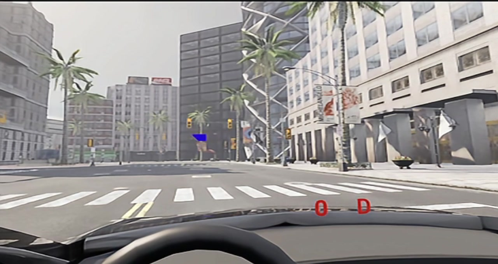
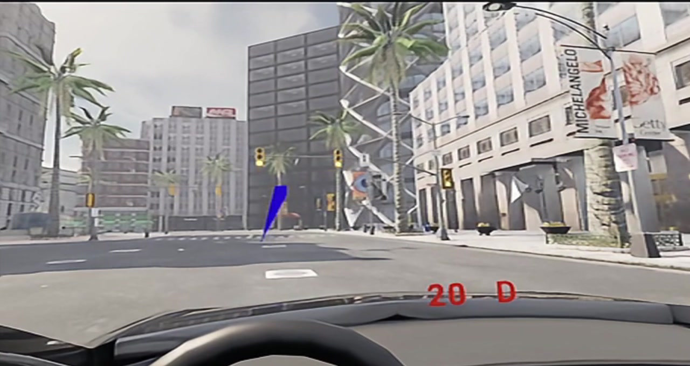
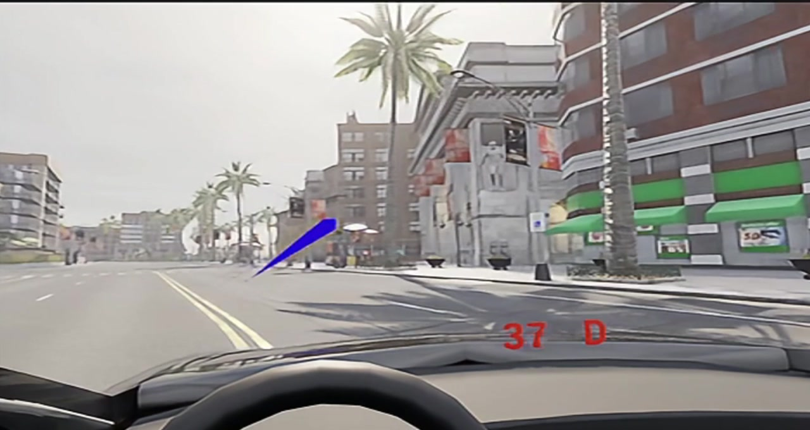
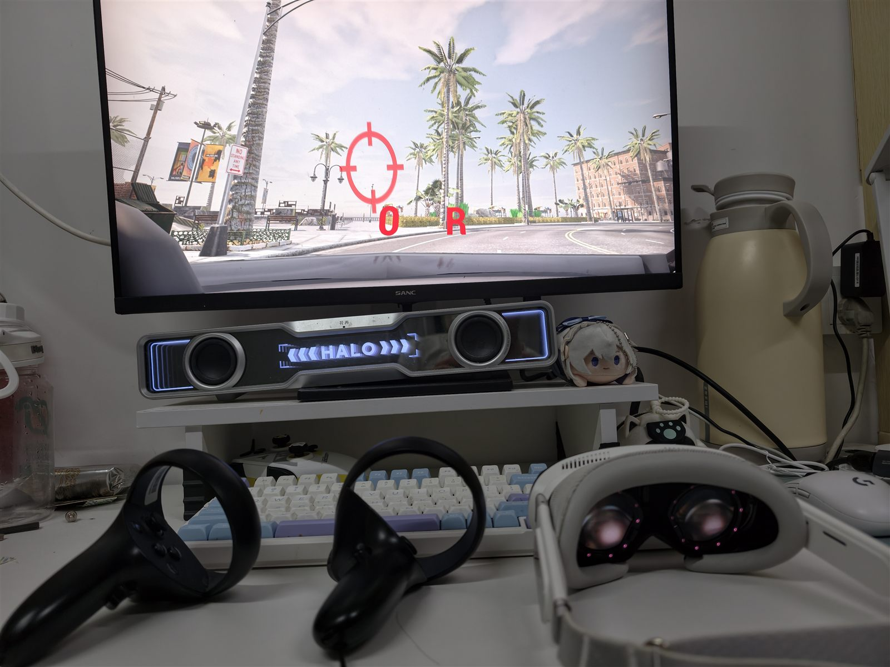
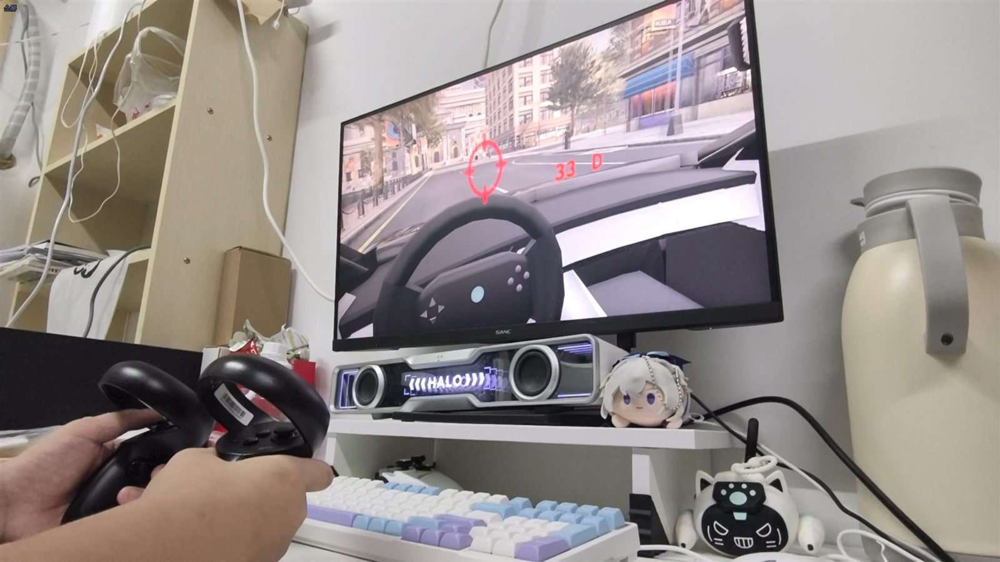
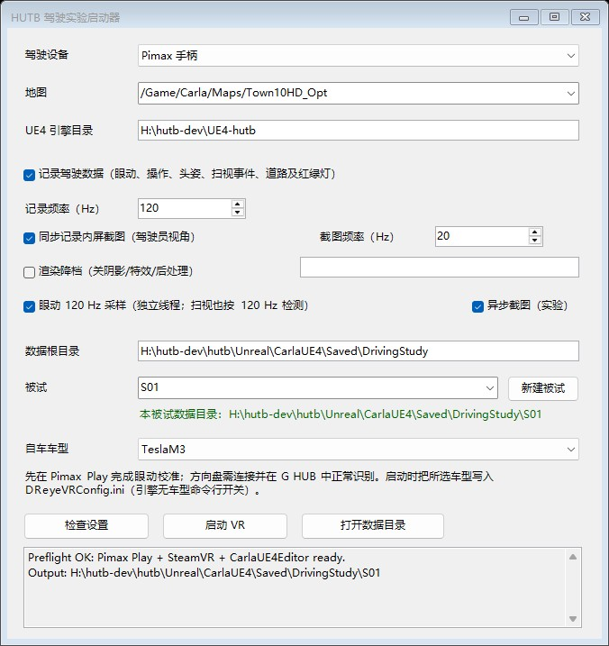

# Pimax Dream Air 驾驶与眼动追踪

本页介绍如何在 OpenHUTB（DReyeVR）中使用 Pimax Dream Air 系列头显、Crystal 手柄与罗技方向盘，包括手柄/方向盘驾驶、连续调整座椅、combined gaze 眼动追踪、蓝色注视线显示，以及面向驾驶行为实验的**数据收集器与一键实验启动器**。

手柄功能适用于 Pimax SteamVR 驱动识别为 `oculus_touch` 的设备；眼动追踪与数据收集器目前已在 **Pimax Dream Air + 罗技 G29 方向盘 + Windows + Pimax Play + SteamVR** 环境中完成实机验证。

对应代码改动：

- [Pimax 手柄驾驶与座椅连续移动 OpenHUTB/hutb#3665](https://github.com/OpenHUTB/hutb/pull/3665)
- [Pimax 眼动追踪与相机附着视线 OpenHUTB/hutb#3670](https://github.com/OpenHUTB/hutb/pull/3670)
- [罗技方向盘 G HUB 识别、断连自动重连与输入模式隔离 OpenHUTB/hutb#3676](https://github.com/OpenHUTB/hutb/pull/3676)、[OpenHUTB/hutb#3692](https://github.com/OpenHUTB/hutb/pull/3692)
- [数据收集器（120 Hz 眼动流、在线 I-VT 扫视检测、异步截图）与一键实验启动器 OpenHUTB/hutb#3693](https://github.com/OpenHUTB/hutb/pull/3693)

## 功能状态

| 功能 | Dream Air 验证状态 |
| --- | --- |
| VR 显示与头部追踪 | ✓ |
| 左摇杆转向、扳机油门/刹车、A 键换挡 | ✓ |
| 罗技方向盘转向/踏板、H 挡杆与按键倒挡、断连 2 秒自动重连 | ✓ |
| 右摇杆连续调整座椅前后/左右 | ✓ |
| 左右握把连续降低/升高座椅 | ✓ |
| combined gaze 眼动方向与 0.25 s 值冻结门限 | ✓ |
| 蓝色注视线、焦点检测、录制及 Python API 数据链 | ✓ |
| 数据收集器（71 列主表 `<session>.csv` + 18 列 120 Hz 眼动流 `<session>_gaze.csv` + 在线 I-VT 扫视检测） | ✓ |
| 一键实验启动器（`StartDrivingStudy.cmd`）与异步内屏截图 | ✓ |
| 单眼原点、瞳孔直径、眼睛开合度 | PVR 1.26 接口未提供 |

## 效果预览

静止注视：车辆停止时，蓝色视线随眼球移动并指向道路左前方目标。



行驶跟随：车辆行驶时，蓝色视线保持附着于头显相机。



注视转移：车辆继续行驶时，视线能够转向道路右侧目标，展示 combined gaze 的连续变化。



下面的视频为 Dream Air 实机内录。蓝色注视线的起点固定在头显前方，终点随眼球注视方向移动；车辆行驶时，视线会跟随相机，不会落在车辆后方。


设备图样：Pimax Dream Air 头显与 Crystal 手柄置于桌面，显示器同步输出旁观画面，红字 `0 R` 表示当前车速 0、倒挡。



手柄驾驶：显示器为座舱视角，方向盘随左摇杆实时转动，红字 `33 D` 表示车速读数 33、前进挡。



## 使用前准备

1. 安装并启动 Pimax Play，连接 Dream Air 和 Crystal 手柄。所需运行库随 Pimax Play 安装，无需手动复制 DLL；
2. 在 Pimax Play 中开启眼动追踪并完成眼动校准；
3. 从 Steam 安装 SteamVR，首次手动运行一次并确认头显和手柄正常连接；之后可由启动脚本自动拉起；
4. 使用包含 [OpenHUTB/hutb#3670](https://github.com/OpenHUTB/hutb/pull/3670) 的已编译版本；
5. 建议先关闭不需要的高开销功能，例如三个实时后视镜。

## 配置

在 `Unreal/CarlaUE4/Config/DReyeVRConfig.ini` 中确认以下配置：

```ini
[CameraParams]
SeatMoveSpeedCmPerSecond=75.0

[EgoSensor]
DrawDebugFocusTrace=True
UseCameraRelativeGazeDisplay=True

[Pimax]
EnablePvrEyeTracking=True
AllowUnknownPimaxDevice=False
AllowedVendorIds=0x34A4
AllowedProductIds=0x0012,0x0040,0x0042,0x0044
MaxSampleAgeSeconds=0.5
GazeInvertHorizontal=False
GazeInvertVertical=False
```

Dream Air 的产品 ID 为 `0x0044`。使用其他型号时，确认其 VID/PID 后再加入白名单。

## 启动方法

### 推荐：带检查的启动脚本

在**新版打包程序的根目录**打开 64 位 Windows PowerShell，执行：

```powershell
powershell -NoProfile -ExecutionPolicy Bypass -File .\StartPimaxVR.ps1
```

默认地图为 Town02。切换地图时添加 `-Map /Game/Carla/Maps/Town10HD_Opt`，所选地图须已安装或打包。

**源码开发版**需要先编译引擎和 `CarlaUE4Editor Win64 Development`，然后在源码根目录执行（引擎路径按实际位置修改）：

```powershell
powershell -NoProfile -ExecutionPolicy Bypass -File .\StartPimaxVR.ps1 -UE4Root 'H:\hutb-dev\UE4-hutb' -Map /Game/Carla/Maps/Town10HD_Opt
```

脚本检查 VR 配置、手柄绑定和运行库，自动启动 Pimax Play、SteamVR，再启动游戏。检查失败时，按提示修正后重试。

只检查、不启动任何程序时，在上述命令末尾添加 `-CheckOnly`。SteamVR 路径未登记时可指定 `-SteamVRRoot 'D:\steam\steamapps\common\SteamVR'`。

自行编译/打包时，先在 `CarlaUE4.uproject` 中启用 SteamVR 插件，再使用 `Util/BuildTools/Package.bat` 打包，携带启动脚本及所需配置。

### 手动启动与成功判据

已手动启动 Pimax Play 和 SteamVR 时，打包版的实际游戏命令为：

```powershell
.\CarlaUE4.exe /Game/Carla/Maps/Town02?game=/Script/CarlaUE4.DReyeVRGameMode -game -vr
```

戴上头显，确认显示和手柄正常，并在游戏日志中检查：

```text
Using Pimax PVR eye tracking
Pimax PVR: first valid eye sample
```

确认样本持续更新，蓝色视线随注视方向移动，车辆行驶时视线跟随相机。

## 数据收集器（驾驶实验启动与记录） <span id="data_collector"></span>

针对驾驶行为与眼动交互实验，项目提供了图形化一键实验启动器（`StartDrivingStudy.cmd`）与内置 C++ 数据收集器（`FDrivingRecorder`），支持在实验过程中按被试自动分目录记录同步车辆/道路/信号灯/注视焦点数据、120 Hz 独立后台线程眼动流与在线 I-VT 扫视事件，以及异步驾驶员视角内屏截图。



### 1. 实验启动与采集流程

1. 连接头显，在 Pimax Play 开启眼动并完成校准。使用罗技 G29 / G920 / G923 时，先确认 G HUB 能识别设备、Windows 的 `joy.cpl` 测试中转向和踏板数值正常，再关闭测试窗口。
2. 双击项目或打包根目录的 `StartDrivingStudy.cmd`。
3. 选择 **Pimax 手柄** 或 **罗技方向盘**；源码版填写 UE4 引擎目录，地图与自车车型从项目目录自动列出。
4. 需要采集时勾选“记录驾驶数据”，频率默认 **120 Hz**（课堂轻量分析可改为 **20 Hz**），填写或选择被试名称与保存目录。可按需勾选：
   - **同步记录内屏截图**（默认 **20 Hz**，640×480 JPEG；可叠加勾选 **异步截图** 避免 GPU 回读与编码阻塞游戏主线程）；
   - **眼动 120 Hz 采样**（独立后台线程按硬件原生时间网格采样，并按 120 Hz 执行在线 I-VT 扫视检测）；
   - **渲染降档**（显式关闭阴影、特效与后处理，默认关闭，不影响未勾选时的引擎画质配置）。
5. 点击“检查设置”，通过后点击“启动 VR”。脚本自动启动 Pimax Play、SteamVR 和游戏。
6. 使用方向盘时，首次进入先踩放一次油门和刹车，再开始实验。退出游戏后，点击“打开数据目录”，用 Excel 或数据分析脚本读取 CSV。

记录默认关闭；每次运行生成独立的 `<session>.csv`（主表，71 列）与 `<session>_gaze.csv`（眼动高频流表，18 列），不覆盖之前的数据。源码版默认位置为 `Unreal/CarlaUE4/Saved/DrivingStudy/`，打包版为 `CarlaUE4/Saved/DrivingStudy/`，并在勾选记录或截图且填写合法被试名时自动按 `<数据根目录>\<被试>` 分目录保存（单独勾选内屏截图时同样生成独立的 `<session>_screenshots` 目录）。重载地图或重新生成自车会创建新文件。

选择方向盘后，手柄和键盘不再控制驾驶轴、换挡与转向灯，手柄仍可调整视角和座椅；同时支持外置 H 挡杆倒挡与方向盘面板 `ABXY` 按键切换倒挡。选择手柄后，不读取方向盘驾驶输入；原有键盘驾驶快捷键仍保留。方向盘断连或读取失败时自动施加满刹，并每两秒尝试原地重新连接。

方向盘无响应时，检查 `Unreal/CarlaUE4/Saved/Logs/CarlaUE4.log`：`Logitech SDK initialize: success` 表示接口初始化成功；`Found Logitech wheel` 表示发现可读取的设备；`Logitech wheel sample` 每两秒记录一次转向及踏板数值。初始化成功不等于输入正常，须确认实际操作时数值变化。请勿仅因游戏无响应就卸载或降级驱动。

命令行也可直接启动数据收集器：

```powershell
powershell -NoProfile -ExecutionPolicy Bypass -File .\StartPimaxVR.ps1 -UE4Root '<UE4 源码引擎根目录>' -Map /Game/Carla/Maps/Town10HD_Opt -InputDevice wheel -RecordDriving -RecordHz 120 -EyeThreadHz 120
```

- 手柄使用 `-InputDevice controller`；不记录时省略 `-RecordDriving`。
- 课堂轻量采集可指定 `-RecordHz 20`。
- 可通过 `-RecordDirectory <本地绝对路径>` 指定输出目录（缺省为 `Unreal\CarlaUE4\Saved\DrivingStudy`）。
- 附加开关：`-ScreenshotDriving -ScreenshotHz 20`（保存视角截图，单独开启时同样支持 `-RecordDirectory`）、`-AsyncScreenshot`（异步 GPU 回读与编码）、`-EyeThreadHz 120`（独立眼动采样线程）、`-PerfDowngrade`（显式关闭阴影/特效/后处理并在本次启动前清理残留 `Scalability.ini`）。

自行编译需启用 `LogitechWheelPlugin` 和 `SteamVR`；更新后的 Windows 打包脚本（`Util/BuildTools/Package.bat`）会自动携带启动器与 `Config/EgoVehicles/*.ini`。

### 2. 主表 `<session>.csv` 字段含义（71 列）

每行对应同一次游戏线程采样：复用当前眼动、命中对象、头姿、在线扫视指标及驾驶输入，同时读取地图和信号灯状态。不是视频，也不是生理/心理反应的自动判定。

| 字段 | 含义 |
| --- | --- |
| `schema_version` | CSV 格式版本（当前为 `2`） |
| `ue_frame`, `sim_time_s`, `host_elapsed_s` | UE 帧号、仿真时间、记录开始后的真实时间（秒） |
| `eye_device_timestamp_ms` | 眼动设备时间戳（毫秒），与仿真时间不是同一个时钟 |
| `input_mode`, `wheel_connected`, `autopilot` | 选择的输入模式、方向盘接口连接状态、自动驾驶状态 |
| `map`, `vehicle_id` | 地图和自车 CARLA ID |
| `road_id`, `lane_id`, `road_s_m` | OpenDRIVE 道路、车道及道路纵向位置 |
| `junction_id`, `in_junction` | 路口 ID、是否处于路口；无道路匹配时为空 |
| `motion`, `yaw_rate_deg_s` | 根据车速与朝向变化标记 `stopped`/`straight`/`left`/`right`；首行 `unknown` |
| `red_light_stop_candidate` | 影响本车的灯为红色（`red`）且车速低于 1 km/h，仅为筛选条件，不代表已经证明停车原因 |
| `traffic_light_id`, `traffic_light_state`, `traffic_light_distance_m` | 影响本车的信号灯及灯杆距离；未进入其触发范围时状态可能 `unknown` |
| `vehicle_x_m`, `vehicle_y_m`, `vehicle_z_m`, `vehicle_yaw_deg`, `speed_kmh` | 自车全局坐标（米）、朝向（度）、车速（km/h） |
| `steer_input`, `throttle_input`, `brake_input` | 本帧驾驶输入：转向通常 -1～1，油门/刹车通常 0～1，已包含项目输入缩放 |
| `previous_applied_steer`, `previous_applied_throttle`, `previous_applied_brake`, `previous_reverse` | 采样时引擎已有的控制值和倒挡状态；本帧输入尚未提交，不能与本帧输入混为一谈 |
| `eye_source`, `gaze_valid` | 眼动来源与有效性；`dummy` 为模拟数据，不作为有效眼动 |
| `gaze_origin_x_m`, `gaze_origin_y_m`, `gaze_origin_z_m`, `gaze_dir_x`, `gaze_dir_y`, `gaze_dir_z` | 注视射线全局起点（米）、单位方向 |
| `gaze_local_x`, `gaze_local_y`, `gaze_local_z` | 相对头显相机的眼动方向，便于区分转头和转眼 |
| `focus_hit`, `focus_actor_id`, `focus_actor_name`, `focus_kind` | 是否命中场景物体，以及物体 ID、名称、类别 |
| `focus_x_m`, `focus_y_m`, `focus_z_m`, `focus_distance_m` | 命中位置与距离（米）；无有效命中时为空 |
| `focus_traffic_light_state`, `looking_at_affecting_light` | 被注视灯的状态，以及命中对象是否恰好为影响本车的灯 |
| `head_x_m`, `head_y_m`, `head_z_m`, `head_pitch_deg`, `head_yaw_deg`, `head_roll_deg` | 头显相机的全局位置（米）与全局姿态角（度） |
| `gaze_h_deg`, `gaze_v_deg` | 双眼合成视线水平偏角 `atan2(Y, X)` 与垂直偏角 `atan2(Z, sqrt(X²+Y²))`（度） |
| `focus_actor_yaw_deg`, `focus_actor_pitch_deg`, `focus_actor_roll_deg` | 被注视物体的全局姿态角（度）；无有效命中时为空 |
| `gaze_velocity_deg_s`, `saccade_state`, `saccade_onset_s`, `saccade_amplitude_deg`, `saccade_peak_velocity_deg_s` | 视线角速度（度/秒）及在线 I-VT 扫视检测状态（`fixation`/`saccade`）、扫视起点仿真时间、扫视幅度与峰值角速度 |
| `sample_dt_ms` | 与上一条记录之间的仿真时间步长（毫秒） |

### 3. 眼动高频流表 `<session>_gaze.csv` 字段含义（18 列）

按眼动仪硬件原生时间网格独立输出，记录已闭合扫视事件裁决：

| 字段 | 含义 |
| --- | --- |
| `device_time_ms`, `host_recv_s`, `sim_time_s`, `ue_frame` | 眼动设备时间戳（毫秒）、主机接收时间（秒）、仿真时间（秒）与对应 UE 帧号 |
| `comb_h_deg`, `comb_v_deg`, `l_h_deg`, `l_v_deg`, `r_h_deg`, `r_v_deg` | 双眼融合水平/垂直偏角（度）与 runtime 报告的左右眼字段（Pimax PVR 1.33.1 下 `l_*`/`r_*` 为融合视线 ±2° 合成值，左右差恒为 `4.0000°`，分析请只使用 `comb_h_deg`/`comb_v_deg`） |
| `vergence_deg`, `valid` | 两条 runtime 射线的夹角（度，Pimax PVR 下为合成值，勿用于辐辏分析）及样本有效标记（`1`/`0`） |
| `gaze_vel_deg_s`, `saccade_state` | 瞬时视线角速度（度/秒）与闭合裁决后的状态（`fixation` / `saccade` / `rejected` / `saccade_open`） |
| `saccade_onset_s`, `saccade_amp_deg`, `saccade_peak_deg_s`, `saccade_samples` | 扫视事件闭合后的起点时间、总幅度（度）、峰值角速度（度/秒）与持续样本数（同一事件内各行一致） |

坐标采用 UE/CARLA 左手系（X 前、Y 右、Z 上）；支持大型地图坐标偏移。转向输入不是方向盘的物理角度，不能直接当作“转了多少度”。对象 ID 仅在当前运行中使用，跨次实验应按地图、道路/车道/路口编号及坐标对照。

无效眼动仍保留该行车辆与道路数据，但眼动及命中坐标留空。视线检测依赖场景碰撞体，命中灯杆或附近模型不代表确实看到了信号灯灯面。红灯状态仅采用 CARLA 当前影响本车的灯，不把“附近任意红灯”作为本车红灯。

### 4. 筛选示例与性能说明

- **转弯时看哪里：**筛选 `in_junction=1`、`motion=left/right`、`gaze_valid=1`，比较 `steer_input`、`gaze_local_*`、`head_yaw_deg` 和 `focus_*`。
- **等红灯时怎么操作：**筛选 `red_light_stop_candidate=1`，按 `sim_time_s` 查看油门、刹车和注视对象；用 `traffic_light_id` 区分不同信号灯。

分析时保留时间列和无效标记，不要把缺失的眼动补成零。要计算红灯出现后的反应时，可取同一 `traffic_light_id` 的灯态变化与刹车变化的时间差；本程序只记录数据，不自动给出因果结论。

- 主表默认目标采样率为 **120 Hz**（最多每渲染帧一行，低帧率时不补造样本；轻量课堂实验可设为 **20 Hz**）。开启 `-EyeThreadHz 120` 时，`<session>_gaze.csv` 由独立后台线程按 120 Hz 采集并运行在线 I-VT 扫视检测（阈值：起始 120 deg/s、结束 60 deg/s、最短持续 20 ms）。暂停不采样。
- CSV 使用缓冲写入，每秒刷新一次。正常退出会关闭文件并冲刷未决扫视样本；异常断电可能丢失末尾未落盘内容。磁盘写入失败会停止记录，并在游戏日志中提示 `Driving study: write failed`；正常开始记录会输出 CSV 路径。

## 自动测试（不需要连接头显）

需要 Windows 上已编译的引擎、项目 Editor 模块及项目资源，无需连接头显或安装 Pimax SDK。

在**源码根目录**执行：

```powershell
powershell -NoProfile -ExecutionPolicy Bypass -File .\Util\Tests\RunPimaxTests.ps1 -UE4Root 'H:\hutb-dev\UE4-hutb'
```

脚本运行以下 14 项测试：

| 测试名称 | 检查内容 |
| --- | --- |
| `HUTB.Pimax.EyeTracking.Freshness` | 眼动样本时间戳与新鲜度判断 |
| `HUTB.Pimax.EyeTracking.FrozenValue` | 眼动方向值连续冻结超过 0.25 s 时的拒绝与恢复判据 |
| `HUTB.Pimax.EyeTracking.AsyncThread` | 独立后台轮询线程环形队列排空与样本序号单调递增 |
| `HUTB.Pimax.GazeDisplay.CameraAttachment` | 调试视线附着于相机及更新依赖 |
| `HUTB.Pimax.GazeDisplay.FixedAnchor` | 视线起点固定、终点跟随注视方向 |
| `HUTB.Pimax.SeatInput.DeadZone` | 座椅输入死区、连续移动计算及 `DefaultInput.ini` 四轴绑定核验 |
| `HUTB.Pimax.Runtime.DiscoveryPaths` | 非 C 盘系统、自定义安装路径、去重及拒绝相对路径覆盖 |
| `HUTB.Pimax.Driving.Csv` | CSV 字段转义与数值格式化 |
| `HUTB.Pimax.Driving.Motion` | 车辆运动状态（`stopped`/`straight`/`left`/`right`）分类 |
| `HUTB.Pimax.Driving.InputMode` | 启动命令行输入模式（`controller`/`wheel`/`legacy`）解析 |
| `HUTB.Pimax.Driving.WheelReconnect` | 罗技方向盘未就绪启动、2 秒原地重连与重试态退出清理 |
| `HUTB.DReyeVR.Gaze.SaccadeDetector` | 在线 I-VT 扫视检测器阈值、回退基线与短瞬态拒绝 |
| `HUTB.DReyeVR.Gaze.SaccadeStamping` | 眼动流闭合扫视事件回填与超长事件 `saccade_open` 一致性 |
| `HUTB.DReyeVR.LiveCapture.AsyncQueue` | 异步截图有界队列、背压丢帧统计与退出排空 |

报告保存在 `Unreal/CarlaUE4/Saved/Automation/Pimax-时间戳/`，也可用 `-ReportPath 'D:\HUTB-test\run-001'` 指定尚不存在的目录。输出 `PASS`、退出码为 0 表示全部通过；失败时查看报告中的 `automation.log` 和 `index.json`。

启动脚本另外提供轻量隔离测试，只需 Windows PowerShell 5.1，无需 UE4、Pimax Play 或 SteamVR：

```powershell
powershell -NoProfile -ExecutionPolicy Bypass -File .\Util\Tests\TestPimaxLauncher.ps1
powershell -NoProfile -STA -ExecutionPolicy Bypass -File .\StartDrivingStudy.ps1 -ValidateOnly
```

该测试模拟启动过程，检查配置拦截、被试目录边界、启动顺序及参数传递，不会实际启动软件。发布前还需连接头显与方向盘验证 VR 画面、眼动、手柄/方向盘操作及断连恢复。

## 手柄键位

| 功能 | 操作 |
| --- | --- |
| 转向（比例） | 左摇杆左右 |
| 油门（比例） | 右手扳机 |
| 刹车（比例） | 左手扳机 |
| 倒挡/前进挡切换 | A |
| 左转向灯 | X |
| 右转向灯 | B |
| 下一个摄像机视角 | Y |
| 上一个摄像机视角 | 右摇杆按下 |
| 自车/旁观视角切换 | 左摇杆按下 |
| 座椅升高 / 降低 | 右手柄握把 / 左手柄握把 |
| 座椅前后左右移动 | 右摇杆四向 |

## 常见问题

### 找不到 Pimax Play、运行库或 SteamVR

先确认 Pimax Play 和 SteamVR 已安装。自定义安装目录时，在启动命令末尾添加对应参数（路径按实际位置修改）：

```powershell
-PimaxRoot 'E:\VR\Pimax'
-PvrDllPath 'E:\VR\Pimax\Runtime\libPVRClient64.dll'
-SteamVRRoot 'D:\steam\steamapps\common\SteamVR'
```

DLL 路径须为 Pimax Play 所安装文件的本地绝对路径。

### 能识别设备，但没有眼动数据

如果日志持续出现 `timestamp-zero`，或者没有 `first valid eye sample`：

1. 退出模拟器；
2. 在 Pimax Play 中确认眼动追踪开关已开启；
3. 重新运行一次眼动校准；
4. 若仍无数据，重启 Pimax Play 或 Pimax 眼动运行时；
5. 确认眼动数据恢复后再启动模拟器。

### 有眼动数据，但看不到蓝色视线

确认 `DrawDebugFocusTrace=True` 和 `UseCameraRelativeGazeDisplay=True`，修改配置后重新启动模拟器。还应检查样本是否因时间戳停止更新而被判定为过期。

### 视线方向左右或上下相反

完成眼动校准后再测试。如坐标方向仍然相反，可分别调整：

```ini
GazeInvertHorizontal=True
GazeInvertVertical=True
```

只修改实际相反的轴。

### 右摇杆无法连续调整座椅

确认 SteamVR 使用当前应用的 Pimax/`oculus_touch` 绑定，并检查右摇杆是否绑定到标准 `vector2 position` action。

### 注视后视镜时严重掉帧

DReyeVR 的三个后视镜会额外渲染场景，VR 中开销较高。测试眼动追踪时可在车辆配置中暂时关闭：

```ini
RearMirrorEnabled=False
LeftMirrorEnabled=False
RightMirrorEnabled=False
```

## 已知限制

- 眼动后端目前只在 Windows 和 Pimax Dream Air 上完成实机验证；
- PVR 1.26 当前只提供 combined gaze 和设备时间戳，单眼原点、瞳孔直径和眼睛开合度保持无效状态；
- Pimax Runtime 更新 ABI 或安装位置后，可能需要同步更新后端；
- SRanipal 和 Pimax 眼动后端同时开启时，DReyeVR 优先使用 SRanipal；
