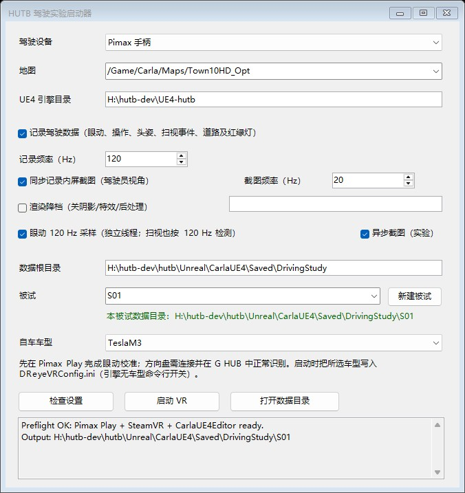
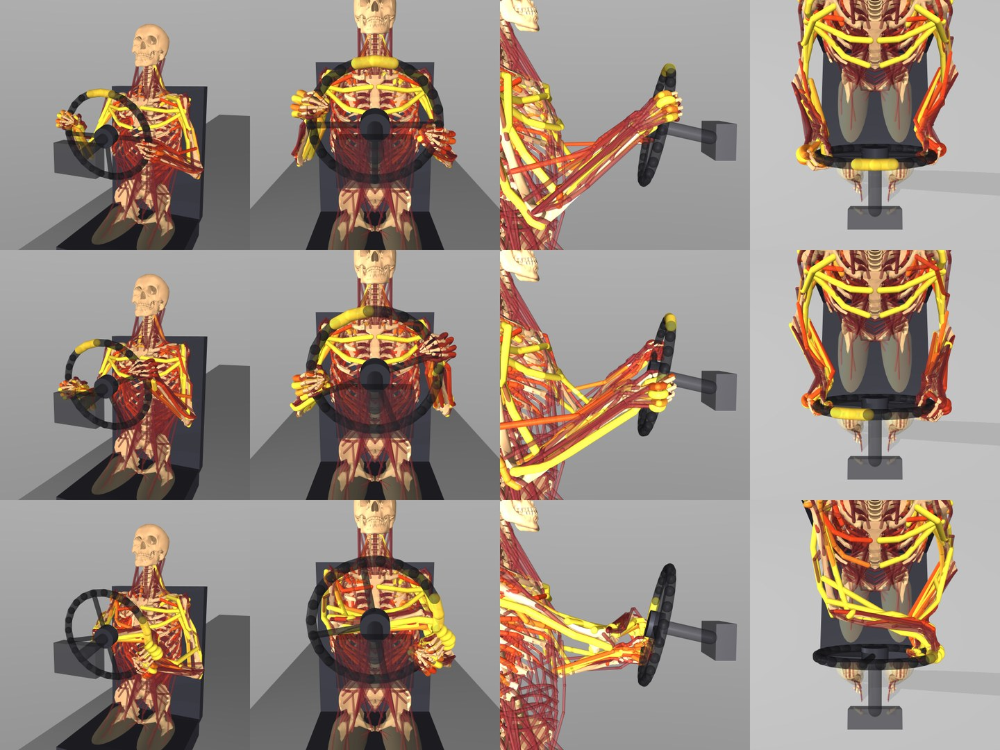
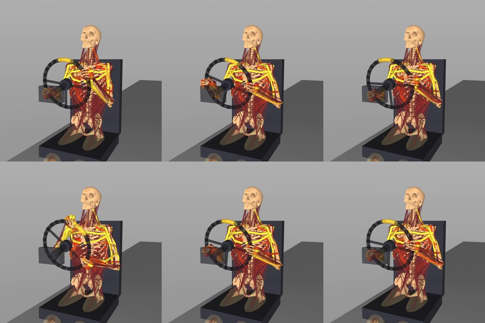

# 驾驶实验启动器与数据采集

## 快速开始

1. 连接头显，在 Pimax Play 中启用眼动追踪并完成校准。若使用罗技 G29 / G920 / G923 方向盘，请先确认 Logitech G HUB 已识别设备，并在 Windows `joy.cpl` 中确认转向与踏板轴响应正常后关闭测试窗口。
2. 在源码仓库根目录（支持 `setup.bat -l` 生成的 `Build\engine` 与同级引擎目录自动识别，即使 `UE4_ROOT` 未设置或指向旧路径也可直接启动）或 `setup.bat -p` 打包产物根目录（`WindowsNoEditor`）中双击 `StartDrivingStudy.cmd`。



> 上图为较早版本的启动器界面示意；最新版在**眼动 120 Hz 采样**与**数据根目录**之间新增了**记录手柄位姿**复选框。

3. 选择**驾驶设备**（**Pimax 手柄** 或 **罗技方向盘（G29 / G920 / G923）**）。源码模式下会自动填充**UE4 引擎目录**（`setup.bat -l` 或同级引擎目录，打包版会显示“打包版无需填写”并禁用输入框），并从工程目录自动发现已安装**地图**与**自车车型**。
4. 如需采集实验数据，请勾选**记录驾驶数据（眼动、操作、头姿、扫视事件、道路及红绿灯）**。默认目标采样率为 **120 Hz**（轻量课堂实验可设为 **20 Hz**），填写或通过**新建被试**创建**被试**名称并确认**数据根目录**。可选开关包括：

    - **同步记录内屏截图（驾驶员视角）**：默认 **20 Hz**、640×480 JPEG；可勾选右侧**异步截图（实验）**，使 GPU 回读与 JPEG 编码在独立线程执行，避免阻塞游戏主线程。
    - **眼动 120 Hz 采样（独立线程；扫视也按 120 Hz 检测）**：在后台专用线程按硬件原生频率轮询眼动仪，并在该 120 Hz 流上执行在线 I-VT 扫视事件检测。
    - **记录手柄位姿（双手 6DoF + 扳机/握把，上肢数字人用）**：默认关闭；开启后会在主表中填充额外的 18 列双手手柄位姿，供下方“肌肉骨骼上肢回放”驱动 MS-Human-700 模型使用。
    - **渲染降档（关阴影/特效/后处理）**：显式设置 `sg.ShadowQuality 0`、`sg.EffectsQuality 0`、`sg.PostProcessQuality 0`，右侧输入框支持附加自定义控制台变量；默认关闭，以保留现有画质与引擎配置。

5. 先点击**检查设置**执行环境预检，确认通过后点击**启动 VR**。启动器将按顺序拉起 Pimax Play、SteamVR 与仿真器。
6. 使用罗技方向盘时，正式开始记录前请先完整踩放一次油门与刹车踏板，使硬件完成踏板行程初始化。退出仿真器后，点击**打开数据目录**即可查看生成的 CSV 文件。

数据采集开关默认关闭。每次开始采集都会新建 `<session>.csv`（71 列；开启手柄位姿时为 89 列）与 `<session>_gaze.csv`（18 列），不会覆盖历史会话。默认输出根目录在源码构建下为 `Unreal/CarlaUE4/Saved/DrivingStudy/`，在打包版本下为 `CarlaUE4/Saved/DrivingStudy/`；只要填写了合法被试名且启用了数据采集或内屏截图，文件均保存至 `<数据根目录>/<被试>/`。重新加载地图或重新生成自车将开启新的会话文件。

当选择罗技方向盘模式时，VR 手柄与键盘不再控制转向、油门、刹车、换挡和转向灯（手柄仍可调整座舱视角/座椅位置）；当选择手柄模式时，方向盘驾驶轴输入会被忽略，键盘快捷键仍正常可用。在方向盘模式下若检测到方向盘断连或读取失败，系统会自动施加满刹车，并每 2 秒尝试原地重连。

如果方向盘无响应，请查看 `Unreal/CarlaUE4/Saved/Logs/CarlaUE4.log`：

- `Logitech SDK initialize: success`：DirectInput / Logitech SDK 初始化成功。
- `Found Logitech wheel`：已打开受支持的方向盘设备。
- `Logitech wheel sample`：每 2 秒打印一次原始转向与踏板轴数值。

同时也支持命令行直接启动：

```powershell
powershell -NoProfile -ExecutionPolicy Bypass -File .\StartPimaxVR.ps1 -UE4Root '<UE4 引擎根目录>' -Map /Game/Carla/Maps/Town10HD_Opt -InputDevice wheel -RecordDriving -RecordHz 120 -EyeThreadHz 120
```

- 手柄驾驶可传 `-InputDevice controller`；仅调试或驾驶不采集数据时省略 `-RecordDriving`。
- 可传入 `-RecordHz 20` 进行轻量级 20 Hz 采集，或传入 `-RecordDirectory <本地绝对路径>` 指定输出目录。
- 常用可选参数：`-ScreenshotDriving -ScreenshotHz 20`（单独截图时同样支持 `-RecordDirectory`）、`-AsyncScreenshot`、`-EyeThreadHz 120`、`-HandPose`、`-PerfDowngrade`。
- 若从 `setup.bat -l` 或同级引擎目录运行，`StartPimaxVR.ps1` 也会自动识别引擎目录，无需强制传入 `-UE4Root`。

从源码编译需确保 `CarlaUE4.uproject` 中已启用 `LogitechWheelPlugin` 与 `SteamVR` 插件。


## CSV 字段说明

### 1. 主驾驶表 `<session>.csv`（71 列，含手柄位姿时为 89 列）

每一行对应一个游戏线程采样点，整合了当前眼动追踪状态、视线射线命中结果、头显位姿、在线扫视指标、车辆运动学、驾驶输入、OpenDRIVE 道路定位与影响本车的信号灯状态。

| 列名 | 说明 |
| --- | --- |
| `schema_version` | CSV 结构版本（`3`；新增手柄位姿列之前为 `2`） |
| `ue_frame`, `sim_time_s`, `host_elapsed_s` | UE 帧号、仿真时间戳（秒）、录制开始以来的墙钟耗时（秒） |
| `eye_device_timestamp_ms` | 眼动设备时间戳（毫秒）；使用设备硬件时钟而非仿真时间 |
| `input_mode`, `wheel_connected`, `autopilot` | 所选驾驶模式（`controller` / `wheel`）、方向盘连接状态、自动驾驶状态 |
| `map`, `vehicle_id` | 地图资产名与自车 CARLA Actor ID |
| `road_id`, `lane_id`, `road_s_m` | OpenDRIVE 道路 ID、车道 ID 与纵向 `s` 坐标（米） |
| `junction_id`, `in_junction` | OpenDRIVE 路口 ID 及是否位于路口内（`1`/`0`）；离开道路时为空 |
| `motion`, `yaw_rate_deg_s` | 运动状态标签（`stopped` 静止、`straight` 直行、`left` 左转、`right` 右转；首行为 `unknown`）及横摆角速度（度/秒） |
| `red_light_stop_candidate` | 当影响本车的信号灯为红灯且车速低于 1 km/h 时为 `1`（仅作红灯停车筛选辅助，不代表因果判定） |
| `traffic_light_id`, `traffic_light_state`, `traffic_light_distance_m` | 影响本车的信号灯 ID、灯色状态及距灯杆距离（米）；离开触发区域时状态可能为 `unknown` |
| `vehicle_x_m`, `vehicle_y_m`, `vehicle_z_m`, `vehicle_yaw_deg`, `speed_kmh` | 自车世界坐标（米）、航向角（度）与车速（km/h） |
| `steer_input`, `throttle_input`, `brake_input` | 当前帧控制输入（转向在 `[-1, 1]`，油门/刹车在 `[0, 1]`，经工程输入缩放处理） |
| `previous_applied_steer`, `previous_applied_throttle`, `previous_applied_brake`, `previous_reverse` | 当前帧输入刷入车辆之前，已生效的转向/油门/刹车控制量及倒挡状态 |
| `eye_source`, `gaze_valid` | 眼动追踪后端（`pimax_pvr`、`sranipal`、`dummy` 等）及有效性标志（`1`/`0`；`dummy` 始终为无效） |
| `gaze_origin_x_m`, `gaze_origin_y_m`, `gaze_origin_z_m`, `gaze_dir_x`, `gaze_dir_y`, `gaze_dir_z` | 世界坐标系下的注视射线起点（米）与单位方向向量 |
| `gaze_local_x`, `gaze_local_y`, `gaze_local_z` | 相机局部坐标系下的注视单位方向向量（用于剥离头部转动与眼球转动） |
| `focus_hit`, `focus_actor_id`, `focus_actor_name`, `focus_kind` | 注视射线是否命中场景对象（`1`/`0`），以及命中对象 ID、名称与语义类别 |
| `focus_x_m`, `focus_y_m`, `focus_z_m`, `focus_distance_m` | 世界空间命中位置与距离（米）；`focus_hit=0` 时为空 |
| `focus_traffic_light_state`, `looking_at_affecting_light` | 所注视信号灯的状态，以及所注视对象是否恰为当前影响本车的信号灯（`1`/`0`） |
| `head_x_m`, `head_y_m`, `head_z_m`, `head_pitch_deg`, `head_yaw_deg`, `head_roll_deg` | 世界坐标系下头显相机位置（米）与姿态角（度） |
| `gaze_h_deg`, `gaze_v_deg` | 合成水平注视角（`atan2(Y, X)`）与垂直注视角（`atan2(Z, sqrt(X^2+Y^2))`）（度） |
| `focus_actor_yaw_deg`, `focus_actor_pitch_deg`, `focus_actor_roll_deg` | 被注视 Actor 的世界朝向（度）；`focus_hit=0` 时为空 |
| `gaze_velocity_deg_s`, `saccade_state`, `saccade_onset_s`, `saccade_amplitude_deg`, `saccade_peak_velocity_deg_s` | 注视瞬时角速度（度/秒）、在线 I-VT 扫视状态（`fixation` / `saccade`）、扫视起始仿真时间（秒）、幅度（度）与峰值角速度（度/秒） |
| `sample_dt_ms` | 与上一行记录之间的仿真时间间隔（毫秒） |

#### 可选的手柄位姿列（18 列，命令行 `-HandPose` / 界面**记录手柄位姿**）

该组列位于 `sample_dt_ms` 之前，仅当 `-DReyeVRHandPose` 传入引擎（命令行 `-HandPose` 或图形界面勾选**记录手柄位姿**）时才会填入数值。未开启该开关时这 18 列同样保留表头但内容为空，因此文件总列数始终保持一致，只有“有值列数”随开关变化。

| 列名 | 说明 |
| --- | --- |
| `hand_l_valid`, `hand_r_valid` | 本帧运行时报告该侧手柄位姿有效时为 `1`，否则为 `0` |
| `hand_l_x_m`, `hand_l_y_m`, `hand_l_z_m`, `hand_r_x_m`, `hand_r_y_m`, `hand_r_z_m` | 手柄（Grip）坐标系原点，**OpenVR 站立追踪空间，单位：米** |
| `hand_l_pitch_deg`, `hand_l_yaw_deg`, `hand_l_roll_deg`, `hand_r_pitch_deg`, `hand_r_yaw_deg`, `hand_r_roll_deg` | 直接从右手系 OpenVR 列基矩阵分解得到的内旋 `Y(yaw)-X(pitch)-Z(roll)` 欧拉角（度） |
| `hand_l_trigger`, `hand_r_trigger` | 来自传统 OpenVR 轴数组 `rAxis[0]` 的扳机轴读数，标称范围 `0..1` |
| `hand_l_grip`, `hand_r_grip` | 来自 `rAxis[1]` 的握持/侧压轴读数，标称范围 `0..1` |

分析前请务必阅读以下限制说明：

- 手柄位姿采用 **OpenVR 站立追踪空间（单位：米）**，而非 UE / CARLA 世界坐标系。在不做显式坐标变换的情况下，不能直接与 `head_*_m`、`vehicle_*_m` 或 `focus_*_m` 数值混用；同一段手部动作在 SteamVR 中重新校准中心或更换游玩区后，记录坐标也会相应变化。
- `trigger` / `grip` 读取自传统 OpenVR 轴数组（`rAxis[0]`、`rAxis[1]`）。在 Pimax Dream Air + SteamVR 下这两项当前读数为 `0.000`，而未映射的轴（`< -0.5`）会写入空值；在将 `0.000` 判作“未按下”前，请先验证实际硬件读数是否随按键变化。
- **不采集逐指关节角。** 手柄仅上报刚体 6-DoF 位姿与两个标量轴，不包含单指弯曲角度；离线数字人回放中的手指抓握姿态需按固定抓握模型假设（见下方回放说明）。
- 当 `hand_*_valid=0`、未勾选开关或非 VR 模式运行时，上述列保持为空。

### 2. 高频眼动流表 `<session>_gaze.csv`（18 列）

在眼动仪原生采样时间网格上连续写入，并附带闭合后的扫视事件判定结果：

| 列名 | 说明 |
| --- | --- |
| `device_time_ms`, `host_recv_s`, `sim_time_s`, `ue_frame` | 眼动设备时间戳（毫秒）、主机接收时间（秒）、仿真时间（秒）及 UE 帧号 |
| `comb_h_deg`, `comb_v_deg`, `l_h_deg`, `l_v_deg`, `r_h_deg`, `r_v_deg` | 双目融合（Cyclopean）水平/垂直视线角（度）及运行时上报的左右眼字段（在 Pimax PVR 1.33.1 下，`l_*` 与 `r_*` 实为基于融合视线附加固定 `4.0000 度`水平偏置的合成值，分析时请以 `comb_h_deg` / `comb_v_deg` 为准） |
| `vergence_deg`, `valid` | 左右射线夹角（度；Pimax PVR 下同样为合成值，请勿用于真实辐辏研究）及采样有效标志（`1`/`0`） |
| `gaze_vel_deg_s`, `saccade_state` | 瞬时注视角速度（度/秒）与闭合事件判定（`fixation` 注视、`saccade` 扫视、`rejected` 已剔除，或 `saccade_open` 未闭合扫视） |
| `saccade_onset_s`, `saccade_amp_deg`, `saccade_peak_deg_s`, `saccade_samples` | 闭合扫视事件的起始时间（秒）、幅度（度）、峰值角速度（度/秒）及样本数（同一闭合事件所属各行数值一致） |

除可选的 `hand_*` 数据块（OpenVR 追踪空间，米）外，所有空间坐标均遵循 UE / CARLA 左手坐标系（X 向前、Y 向右、Z 向上），并兼容大地图原点偏移。当 `gaze_valid=0` 时，车辆与道路相关列仍照常记录，而视线与注视命中坐标保持为空。


## 肌肉骨骼上肢回放

采录得到的 `hand_*` 位姿可用于离线驱动肌肉骨骼上肢数字人：`Util/HandPose/record_hands.py` 可在不启动仿真器的情况下直接采集手柄与头显位姿；`Util/HandPose/replay_arms.py` 则将 CSV 通过 MuJoCo 的 MS-Human-700 模型进行上肢回放，结合解剖学耦合逆运动学（IK）、方向盘几何与转角（`steer_input`）、手柄外壳-握环偏置补偿，以及逆动力学估算的肌肉激活着色，导出 MP4 视频与首/中/末关键帧图像（通过 `setup.bat -p` 构建的发布包也会自动包含 `Util/HandPose/`）。实时 VR 驾驶员角色（`ADReyeVRPawn`）与 `replay_arms.py` 共用同一套一次性自动标定器（`FDReyeVRAutoCalibrator`）：头部连续保持静止 `>= 5 s`（位移 `< 5 cm`、旋转 `< 6 deg`）后，转动方向盘幅度达到 `>= 0.015`（在 `900 度`方向盘上约 `6.8 deg`）即自动完成标定，实验过程中无需被试手动触发 VR 重中心或手部校准。环境安装、命令行参数（`--start`、`--fit`、`--raw-hands`、`--no-muscle`）以及已知限制（手指保持预设握姿不随帧活动、坐姿下肢固定、肌肉激活由逆动力学模型推算而非实测 EMG、默认开启手柄外壳偏置补偿与 `--raw-hands` 的差异、以及手臂可达球面夹紧）详见 [`Util/HandPose/README.md`](https://github.com/OpenHUTB/hutb/blob/hutb/Util/HandPose/README.md)。

多视角握持贴合与逆动力学肌肉激活效果如下（正面、侧面、座舱斜视与俯视交叉转向）：



连续转向过程中的时序回放序列与肌肉激活变化如下：



实际回放视频效果：


## 筛选查询示例

- **转弯注视分配分析**：筛选 `in_junction=1`、`motion` 为 `left`/`right` 且 `gaze_valid=1` 的行，关联分析 `steer_input`、`gaze_local_*`、`head_yaw_deg` 与 `focus_*`。
- **红灯制动行为分析**：筛选 `red_light_stop_candidate=1` 的行并按 `traffic_light_id` 分组，跟踪 `throttle_input`、`brake_input` 与 `focus_*` 随 `sim_time_s` 的变化趋势。


## 性能与验证

- `<session>.csv` 默认目标采样率为 **120 Hz**（每渲染帧至多采样一次，低帧率时不插值；可下调至 **20 Hz**）。启用 `-EyeThreadHz 120` 后，`<session>_gaze.csv` 在独立 120 Hz 线程轮询眼动仪并执行经过实机标定的 I-VT 算法（起始阈值 `120 deg/s`、结束阈值 `60 deg/s`、最小持续时间 `20 ms`）。仿真暂停期间不写入数据。
- CSV 写入器使用带缓冲的 I/O（每秒及会话结束时刷盘）；若磁盘写入失败，录制将安全停止并在日志中输出 `Driving study: write failed`。

开发者自测命令（在源码仓库根目录执行；若使用 `setup.bat -l` 生成的 `Build\engine` 或已设置有效 `UE4_ROOT`，`-UE4Root` 可省略）：

```powershell
powershell -NoProfile -ExecutionPolicy Bypass -File .\Util\Tests\RunPimaxTests.ps1
powershell -NoProfile -ExecutionPolicy Bypass -File .\Util\Tests\TestPimaxLauncher.ps1
powershell -NoProfile -STA -ExecutionPolicy Bypass -File .\StartDrivingStudy.ps1 -ValidateOnly
```

Windows 统一回归测试可通过 `make check.vr`（即 `Util\BuildTools\Check.bat --vr`）触发，除 VR 场景测试外，还会检查源码与打包目录的启动器脚本与 UI、预检测试、`Util\HandPose\*.py` 语法及 `HUTB.*` C++ 自动化测试。
