# HUTB 模拟器 MCP 实现

基于 [MCP（Model Context Protocol）](https://modelcontextprotocol.io/) 和 [FastMCP](https://github.com/jlowin/fastmcp) 框架，为 HUTB 模拟器构建的 AI 交互层。用户可以通过自然语言对话或网页面板，让大模型（默认 Deepseek）直接调用模拟器 API，完成天气设置、车辆/行人生成、复杂场景构建等操作。

!!! 提示
    **项目仓库**：[github.com/OpenHUTB/mcp](https://github.com/OpenHUTB/mcp)。本页是项目文档，README 保留快速入口即可。

<div class="build-buttons">
<p>
<a href="https://github.com/OpenHUTB/mcp" target="_blank" class="btn btn-neutral" title="跳转至 mcp 仓库">
<span class="icon icon-github"></span> mcp 仓库</a>
</p>
</div>

- [__实现原理__](#principles)
    - [整体架构](#overall-architecture)
    - [MCP 协议与 FastMCP 框架](#mcp-protocol-and-fastmcp)
    - [核心组件](#core-components)
- [__实现方法__](#implementation)
    - [环境与依赖](#environment-and-dependencies)
    - [项目结构](#project-structure)
    - [关键代码结构](#code-structure)
- [__使用方法__](#usage)
    - [一键启动（Windows）](#one-click-start)
    - [手动启动流程](#manual-start)
    - [网页快捷按钮面板](#web-button-panel)
    - [对话交互](#chat-interaction)
    - [场景构建示例](#scenario-examples)
    - [常用命令速查](#quick-reference)
    - [环境限制说明](#environment-limitations)

---

## 实现原理 <span id="principles"></span>

### 整体架构 <span id="overall-architecture"></span>

系统分为四层：用户界面、FastMCP 工具层、模拟器 API 客户端、大模型服务。

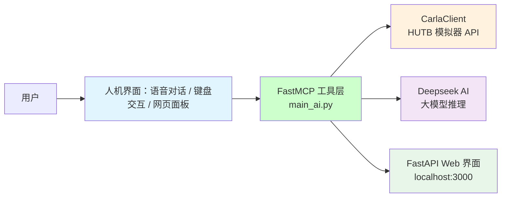

调用流程示意：

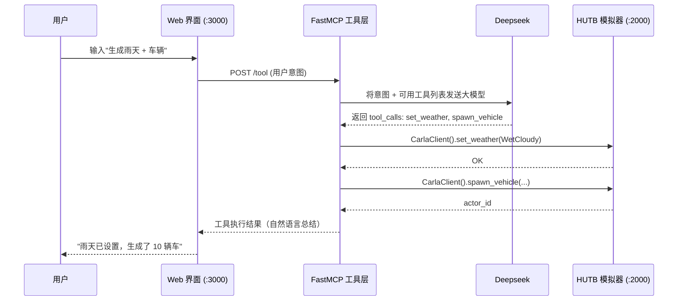

左图为 CARLA 模拟器俯视画面，右图为 Web 界面，实时同步工具调用结果：

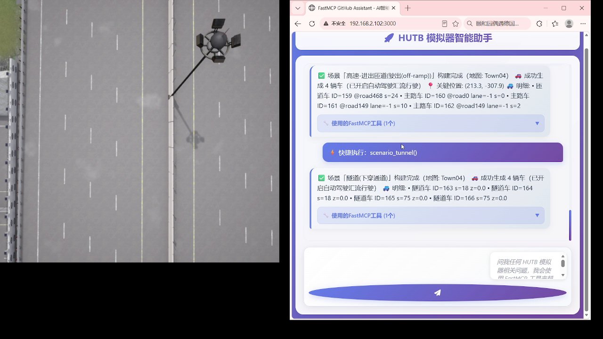

### MCP 协议与 FastMCP 框架 <span id="mcp-protocol-and-fastmcp"></span>

MCP 是一种"让大模型知道有哪些工具可用"的协议。传统做法需要手动编写 JSON Schema 描述每个工具的参数类型、枚举值、必填项——工作量大、容易出错。

FastMCP 在 MCP 之上做了装饰器封装，开发者只需：

1. 写一个普通的 Python 异步函数
2. 加 `@mcp.tool()` 装饰器
3. FastMCP 自动根据类型注解（`int`、`Optional[str]`、`Literal[...]`）生成 JSON Schema

```python
from fastmcp import FastMCP

mcp = FastMCP("HUTB AI 助手")

@mcp.tool()
async def set_weather(weather_type: str) -> str:
    """设置模拟器天气条件。

    Args:
        weather_type: 天气类型，可选 Clear / Cloudy / Wet / WetCloudy / Rain / 等
    """
    client = CarlaClient()
    client.connect()
    # ... 实际调用 carla.WeatherParameters
    return f"已设置天气为 {weather_type}"
```

FastMCP 自动完成：

| 自动处理项 | 说明 |
|---|---|
| 工具注册 | 扫描所有 `@mcp.tool()` 函数，收集元数据 |
| JSON Schema | 根据 Python 类型注解生成 MCP 协议需要的参数描述 |
| 请求路由 | 收到 tool_call 后自动分发到对应函数 |
| 错误处理 | 捕获异常，返回结构化错误给大模型，让它决定是否重试 |
| 结果格式化 | 把函数返回值序列化为大模型可读的自然语言 |

### 核心组件 <span id="core-components"></span>

#### CarlaClient — 模拟器 API 封装

`CarlaClient` 类封装了所有对 HUTB 模拟器的 RPC 调用，内部维护：

- `self.client` — `carla.Client("localhost", 2000)`，底层 Carla RPC 客户端
- `self.world` — 世界对象，用于生成/销毁 actor、设置天气
- `self.actors` — 当前会话生成的 actor 列表，便于清理

每个工具方法遵循"连接 → 执行 → 返回"三段式：

```python
class CarlaClient:
    def connect(self, host="localhost", port=2000):
        self.client = carla.Client(host, port)
        self.client.set_timeout(5.0)
        self.world = self.client.get_world()

    def spawn_vehicle(self, blueprint_id="vehicle.tesla.model3", ...):
        # ... 生成逻辑
```

!!! 注意
    Carla 默认 RPC 端口是 2000。如果模拟器启动时用了 `--carla-rpc-port=<port>`，这里也要对应修改。

#### FastAPI Web 界面

`main_ai.py` 同时启动一个 FastAPI 服务（默认 `localhost:3000`），提供：

- `GET /` — 返回对话页面 HTML
- `POST /chat` — 对话接口（SSE 流式返回）
- `POST /tool` — 直接调用指定工具（供快捷按钮面板使用，绕过大模型）
- `GET /health` — 健康探测（mcp.bat 启动时轮询这个端口判断服务是否就绪）

#### 环境配置

通过 `.env` 文件或系统环境变量提供 API 密钥：

| 变量 | 用途 |
|---|---|
| `DEEPSEEK_API_KEY` | 大模型推理（必填） |
| `CARLA_HOST` | 模拟器地址，默认 `localhost` |
| `CARLA_PORT` | 模拟器 RPC 端口，默认 `2000` |
| `WEB_PORT` | Web 界面端口，默认 `3000` |

---

## 实现方法 <span id="implementation"></span>

### 环境与依赖 <span id="environment-and-dependencies"></span>

**硬件推荐**（来自 README）：

| 项目 | 最低配置 | 推荐配置 |
|---|---|---|
| CPU | Intel i7 gen 9th+ / AMD Ryzen 9 | 同左 |
| 内存 | 16 GB | 32 GB |
| GPU | NVIDIA RTX 3070 | RTX 4070+ |
| 系统 | Windows 10/11 | Windows 11 |

**Python 依赖**（`pip install`）：

```bash
fastapi uvicorn aiohttp fastmcp loguru
carla          # 来自 hutb\PythonAPI\carla\dist\hutb-2.9.16-cp310-cp310-win_amd64.whl
opencv-python  # 用于截图/视频相关功能
```

!!! 重要
    Carla/HUTB Python API 不是 PyPI 包，必须从构建好的 wheel 文件安装：
    `pip install hutb\PythonAPI\carla\dist\hutb-2.9.16-cp310-cp310-win_amd64.whl`

### 项目结构 <span id="project-structure"></span>

```
OpenHUTB/mcp/
├── mcp.bat                 # Windows 一键启动脚本（完整编排）
├── README.md               # 快速入口（保留精简，详情指向本页）
├── llm/
│   ├── main_ai.py          # 核心：FastMCP 工具 + FastAPI Web + CarlaClient（单文件）
│   ├── check_opencv.py     # 启动前检查 OpenCV 是否可用
│   ├── FASTMCP_SETUP.md    # FastMCP 环境搭建详细指南
│   ├── README.md           # 大模型实现说明
│   ├── screenshots/        # 演示截图
│   └── src/
│       ├── github_client.py    # （参考）异步 GitHub API 客户端
│       ├── config.py           # 配置管理
│       └── utils/logger.py     # 结构化日志
├── model/
│   └── humanoid.md         # 人形机器人模拟环境搭建
├── sim/
│   └── README.md           # PR2 机器人仿真集成
└── .github/
```

### 关键代码结构 <span id="code-structure"></span>

#### main_ai.py 内部组织

`main_ai.py` 约 460KB，按功能可划分为：

| 区块 | 行数（约） | 职责 |
|---|---|---|
| import + 路径设置 | 1–30 | 导入 carla、fastmcp、fastapi、aiohttp 等 |
| CarlaClient 类 | 30–800 | 封装所有模拟器 API 调用 |
| FastMCP 工具定义 | 800–2000+ | 每个 `@mcp.tool()` 对应一项模拟器操作 |
| FastAPI 路由 | 末尾 | Web 界面、/chat、/tool、/health |
| 启动入口 | 最后 | `mcp.run()` 或 `uvicorn.run()` |

#### 工具分类速查

`main_ai.py` 中约有 **40+** 个 MCP 工具，按功能分为以下几类（来自 README 常用对话列表）：

| 类别 | 典型工具 |
|---|---|
| 基础操作 | `connect_server`、`set_weather`、`spawn_vehicle`、`set_autopilot`、`switch_view` |
| 道路结构场景 | `build_highway_merge`、`build_highway_diverge`、`build_lane_merge`、`build_intersection` |
| 路口与特殊目标 | `build_traffic_light_intersection`、`build_tunnel`、`build_roundabout`、`spawn_police` |
| 特殊群体与光照 | `spawn_pedestrian_wheelchair`、`set_low_light_condition`、`build_backlight_scene` |
| 危险场景 | `build_sudden_brake`、`build_dangerous_cut_in`、`build_disappear_leading`、`clean_scene` |

---

## 使用方法 <span id="usage"></span>

### 一键启动（Windows） <span id="one-click-start"></span>

双击 `mcp.bat`，脚本自动完成以下编排：

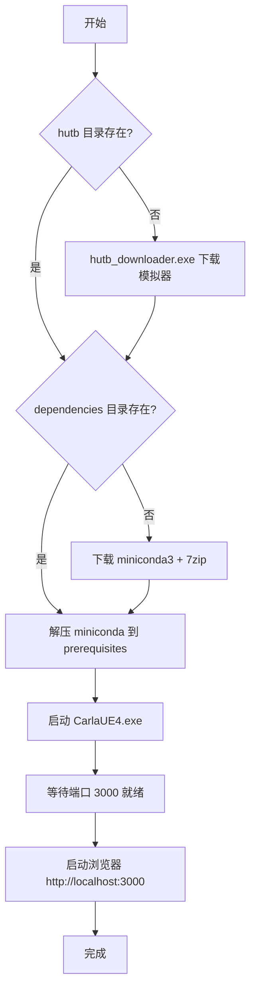

!!! 提示
    首次启动需要下载约 10GB 的模拟器和依赖，会比较慢；后续启动只需几秒。

### 手动启动流程 <span id="manual-start"></span>

适合调试或 Linux 环境：

__1. 启动 HUTB 模拟器（Carla）__

```bash
# Windows
cd hutb && CarlaUE4.exe

# Linux
cd hutb && ./CarlaUE4.sh -RenderOffScreen
```

__2. 激活 Python 环境__

```bash
conda activate hutb_3.10
# 或
source venv/bin/activate
```

__3. 启动 AI 助手__

```bash
# 启动 Web 界面（推荐）—— FastAPI + FastMCP 一体化
python llm/main_ai.py

# 也可以启动 SSE 流式通道（供 Cline 等客户端连接）
python llm/main_ai.py sse

# 或纯 FastMCP 服务器模式
python llm/main_ai.py mcp
```

__4. 浏览器打开__ `http://localhost:3000`

### 网页快捷按钮面板 <span id="web-button-panel"></span>

Web 界面顶部的 **⚡ 场景快捷按钮** 面板按类别分组：

- **匝道汇入** / **匝道驶出** / **车道合并** / **分合流路口** / **辅路**
- **路口+红绿灯** / **隧道** / **环岛** / **儿童姿态** / **二轮车姿态**
- **交警轮椅** / **弱光** / **逆光** / **侧翻车辆** / **前车急刹停止**
- **前车消失** / **路口危险横穿** / **低重叠率目标** / **逆行** / **无保护转弯**
- **连接 CARLA** / **清理场景**

点击按钮 = 直接调用对应 MCP 工具（`POST /tool`），**不经过大模型**，执行速度更快、结果更确定。

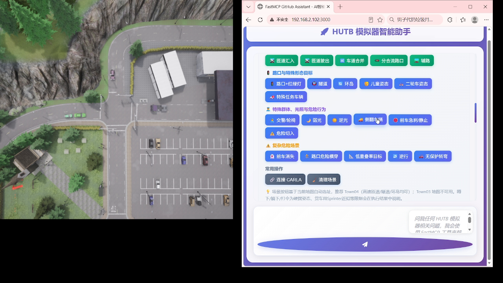

### 对话交互 <span id="chat-interaction"></span>

在 Web 界面输入自然语言，大模型自动拆解并调用对应 MCP 工具。典型对话：

> **用户**: 设置雨天天气条件，然后生成 10 辆车开启自动驾驶
>
> **AI**: 
> 1. 调用 `set_weather(weather_type="WetCloudy")` → ✅ 天气已设置
> 2. 调用 `spawn_vehicle(count=10)` → ✅ 生成了 10 辆车
> 3. 调用 `set_autopilot(enable=True)` → ✅ 所有车辆已开启自动驾驶

大模型理解自然语言意图后，会主动列出支持的参数让用户确认：

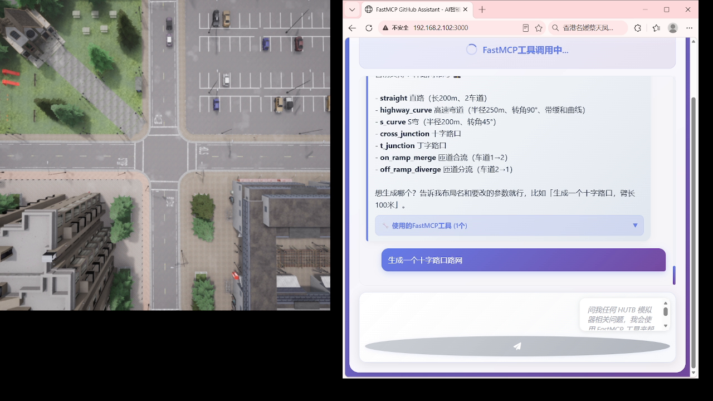

MCP 工具不限于调用模拟器 API，也可以做数据分析。例如对轨迹文件做分布对比：

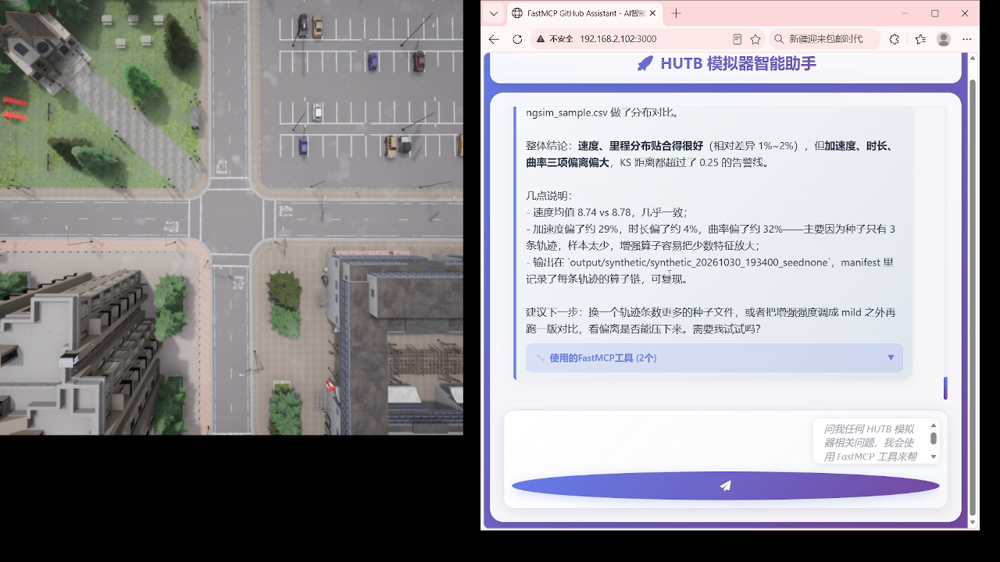

### 场景构建示例 <span id="scenario-examples"></span>

#### 道路结构场景

**匝道汇入 + 驶出**（Town04 地图，自动生成车辆并开启自动驾驶）：


**隧道 + 环岛**：

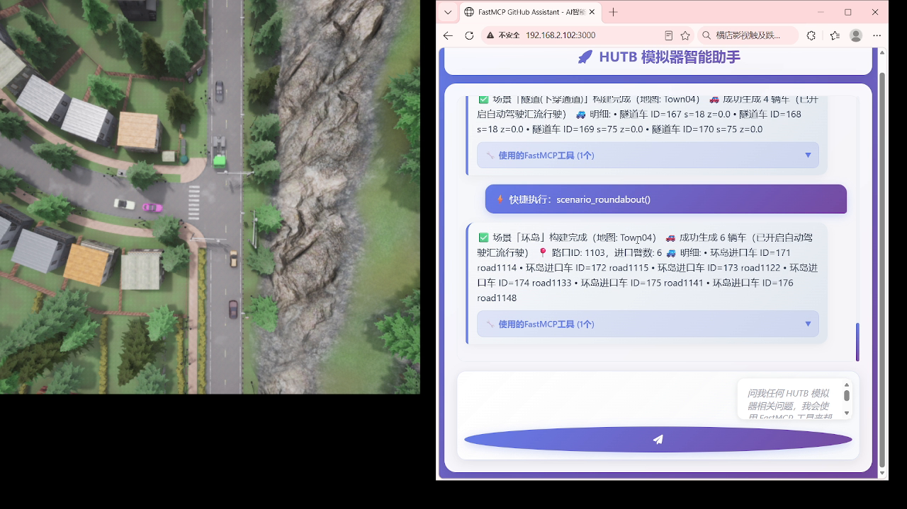

#### 危险场景

**前车消失 + 路口危险横穿**：

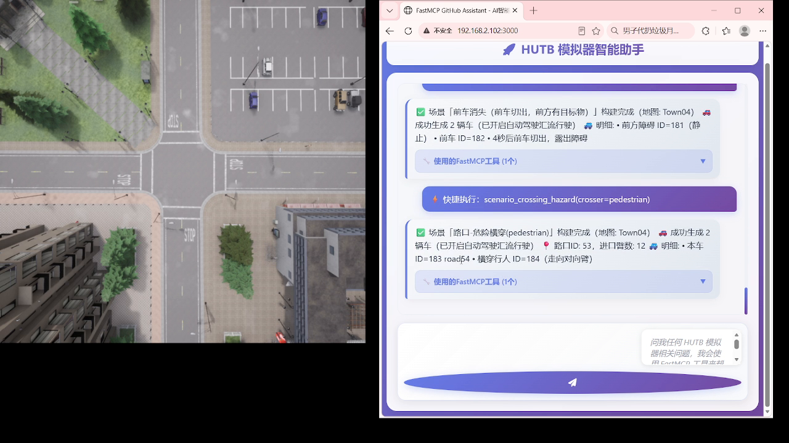

**路口危险横穿 + 无保护转弯**（本车、进口数、横穿行人 ID 等详细信息会全部返回）：

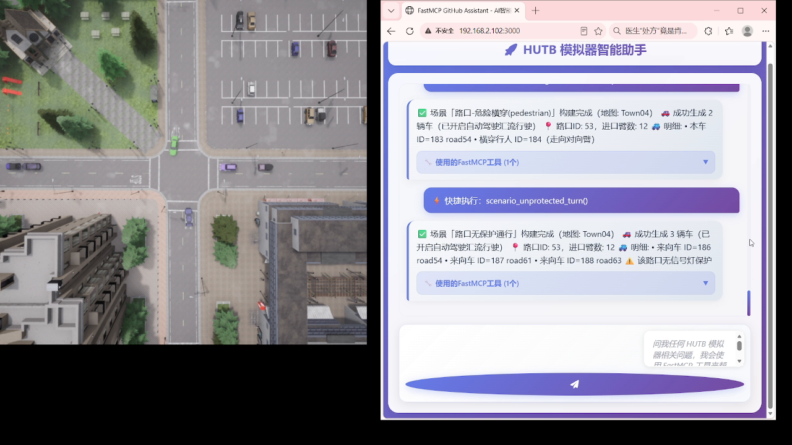

#### 批量生成

一次生成 20 个前车急刹场景（输出 `.xosc` 文件，附带 manifest.json 记录每个场景参数）：

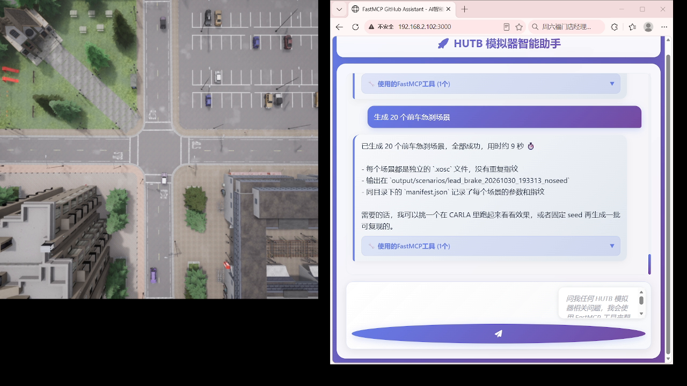

连接 CARLA 后点击快捷按钮即可构建匝道场景：

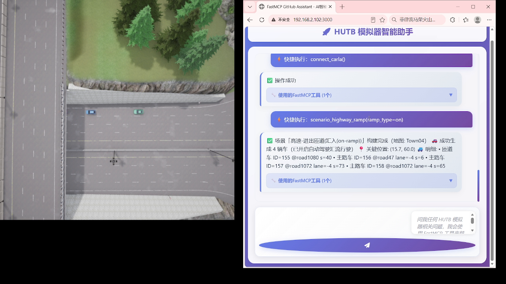

### 常用命令速查 <span id="quick-reference"></span>

**基础操作**：

```
连接服务器
设置雨天天气条件
生成车辆
开启自动驾驶
切换视角
开启录制
清理场景
```

**复杂场景**：

```
构建高速匝道汇入场景
构建城市十字路口红绿灯场景
构建隧道场景
构建环岛场景
构建前车急刹场景
构建路口行人危险横穿场景
```

### 环境限制说明 <span id="environment-limitations"></span>

!!! 警告
    以下限制是已知的，工具会在调用后返回明确的提示信息，不会静默失败：

- **无蓝图实体**：婴儿车、自动配送物流车、动物、施工车辆等在 HUTB 蓝图库中不存在，调用后返回"无法完成"
- **硬摆姿态**：蹲下/躺下/打伞用 `set_transform` 硬设位置旋转，无对应动画
- **隧道检测**：检测目标为桥下/下穿通道，官方地图无地质下沉隧道
- **运行时切图**：会话中使用过自动驾驶后，需用目标地图重启 CARLA 再连接
- **地图限制**：隧道/环岛推荐用 Town04 启动；Town03 加载时崩溃（已禁用）

---

## 参考

* [基于 FastMCP 框架的 GitHub 助手](https://github.com/wink-wink-wink555/ai-github-assistant) — 本项目的 FastMCP 代码骨架来源
* [carla-mcp](https://github.com/shikharvashistha/carla-mcp) — 另一个 Carla + MCP 实现
* [MCP 官方文档](https://modelcontextprotocol.io/)
* [FastMCP GitHub](https://github.com/jlowin/fastmcp)
