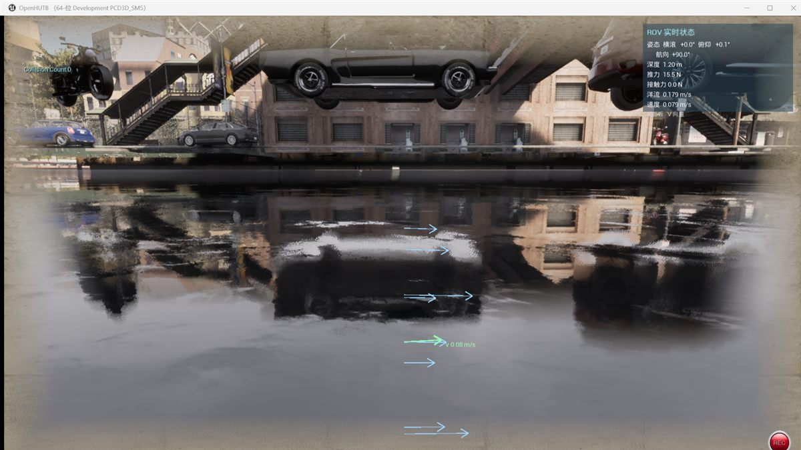

# 水下机器人（ROV）仿真

HUTB 的水下机器人（ROV）仿真由三部分组成：MuJoCo 负责动力学与流体计算，虚幻引擎负责场景渲染，AirSim 负责位姿跟随与 RPC 接口。三者运行在同一个进程中，MuJoCo 是位姿真值源，虚幻引擎中的 ROV 只是它的跟随者，不做二次物理积分。

水下内容（水面、雾、后处理、海床、ROV 模型）已经合并进地图 `Town10HD`，不需要额外加载水下关卡。


## 组成

| 部分 | 作用 |
| :--- | :--- |
| MuJoCo | 动力学、流体阻力、浮力、接触（500 Hz） |
| 虚幻引擎 | 场景渲染、相机、HUD |
| AirSim | 位姿跟随与 RPC 接口（默认端口 41451） |

## 准备

### 使用安装包

1. 安装 `OpenHUTBUnderwaterStudio_<版本>_Setup.exe`
2. 安装程序会把 ROV 配置写入 `文档\AirSim\settings.json`
3. 双击安装目录下的 `CarlaUE4.exe` 启动

### 从源码运行

需要两个仓库：`hutb` 提供代码，`Content` 提供资产（地图、模型、材质）。

| 仓库 | 地址 |
| :--- | :--- |
| hutb | `https://github.com/OpenHUTB/hutb` |
| Content | `https://git.code.tencent.com/OpenHUTB/Content` |

```bash
# 1. 代码
git clone https://github.com/OpenHUTB/hutb.git
cd hutb

# 2. 资产，放到工程的 Content 目录
git clone https://git.code.tencent.com/OpenHUTB/Content.git Unreal/CarlaUE4/Content

# 3. 初始化、编译、启动
setup.bat -l
```

资产仓库使用 Git LFS，克隆后如果出现 0 字节文件，在 Content 目录执行 `git lfs pull`。

## 显式配置 ROV

ROV 模式由 AirSim 配置文件中的 `SimMode` 决定。配置文件有两处，**优先读取工程目录**：

| 位置 | 说明 |
| :--- | :--- |
| `Unreal/CarlaUE4/settings.json` | 工程内，优先级最高 |
| `文档\AirSim\settings.json` | 用户目录，安装包写入的就是这里 |

仓库自带一份 ROV 配置 `settings_rov.json`，直接覆盖即可：

```powershell
copy Unreal\CarlaUE4\settings_rov.json Unreal\CarlaUE4\settings.json
```

关键字段如下：

```json
{
  "SettingsVersion": 1.2,
  "SimMode": "Rov",
  "Vehicles": {
    "RovSimple": {
      "VehicleType": "RovSimple",
      "PawnPath": "DefaultRov",
      "EnableCollisions": true,
      "AllowAPIAlways": true
    }
  }
}
```

| 字段 | 作用 |
| :--- | :--- |
| `SimMode` | 必须是 `"Rov"`，否则启动的是无人机 |
| `Vehicles.RovSimple.VehicleType` | `RovSimple`，ROV 的固件类型 |
| `PawnPath` | `DefaultRov`，对应 `RovPawn` |
| `AllowAPIAlways` | 允许外部 API 控制 |

配置只在启动时读取一次，修改后需要重启。

## 启动

### 编辑器

```powershell
cd <hutb 仓库根目录>
.\run_underwater_scene.bat
```

脚本会自动备份 `settings.json`、换成 ROV 配置、启动编辑器，退出后再还原。手动启动等价于：

```powershell
UE4Editor.exe Unreal\CarlaUE4\CarlaUE4.uproject /Game/Carla/Maps/Town10HD `
  -game -windowed -resx=1600 -resy=900
```

### 打包版

双击安装目录下的 `CarlaUE4.exe`。首次启动约需 1–2 分钟（着色器缓存），属正常现象。

## 操作

| 按键 | 功能 |
| :--- | :--- |
| `W` / `S` | 前进 / 后退 |
| `A` / `D` | 左移 / 右移 |
| `Q` / `E` | 上浮 / 下潜 |
| `←` / `→` | 左转 / 右转 |
| `Z` | 锁定当前深度（再按解除） |
| `R` | 显示 / 隐藏状态面板 |
| `V` | 显示 / 隐藏力与速度向量 |
| `B` / `F` / `M` | 追尾视角 / 第一人称 / 手动 |

状态面板位于屏幕右上角，显示姿态、深度、推力、接触力、洋流和速度。



## 确认是否生效

编辑器日志在 `Saved/Logs/CarlaUE4.log`，打包版在 `CarlaUE4/Saved/Logs/`。启动后应出现以下四行：

```
[RovMuJoCoBridge] ✅ 桥接已启用，跟随 body 'rov'
[RovScene] 障碍物 9 个（管道/框架/礁石）
[RovScene] 实时状态面板已启用
[RovBridge][姿态] 物理线程级联控制启用（500 Hz），锁定航向 90.0°
```

画面上应能看到右上角的状态面板、水面色调与水下雾效；按 `W` 时 ROV 前进。

## Python 控制

ROV 使用 `airsim.RovClient`，状态用 `getRovState()` 获取：

```python
import airsim

client = airsim.RovClient()
client.confirmConnection()
client.enableApiControl(True)
client.armDisarm(True)

state = client.getRovState()
print("位置:", state.kinematics_estimated.position)
```

需要注意：`getMultirotorState()` 属于多旋翼模式，ROV 模式下没有该方法，调用会报 `AttributeError: 'VehicleClient' object has no attribute 'getMultirotorState'`。

完整示例如下：

```python
import airsim
import time

client = airsim.RovClient()
client.confirmConnection()
client.enableApiControl(True)
client.armDisarm(True)

print("初始位置:", client.getRovState().kinematics_estimated.position)

# 机体系速度：前进 0.5 m/s、下潜 0.2 m/s，持续 3 秒
client.moveByVelocityBodyFrameAsync(vx=0.5, vy=0.0, vz=0.2, duration=3).join()
time.sleep(1)

print("运动后位置:", client.getRovState().kinematics_estimated.position)
client.hoverAsync().join()

client.armDisarm(False)
client.enableApiControl(False)
```

常用接口：

| 方法 | 说明 |
| :--- | :--- |
| `getRovState()` | 位姿、速度、着陆状态 |
| `moveByVelocityBodyFrameAsync(vx, vy, vz, duration)` | 机体系速度控制 |
| `moveByVelocityZBodyFrameAsync(vx, vy, z, duration)` | 机体系速度 + 定深 |
| `moveToPositionAsync(x, y, z, velocity)` | 位置控制 |
| `moveByMotorPWMsAsync(pwm_values, duration)` | 直接给推进器 PWM |
| `hoverAsync()` | 悬停 |
| `getImuData()` / `getBarometerData()` / `getMagnetometerData()` | 传感器 |
| `getImages()` | 相机图像 |

`RovClient` 来自本仓库的 `PythonClient`，不是 PyPI 上的 airsim 包：

```powershell
cd <air 仓库>\PythonClient
pip install -e .
```

安装后可用 `hasattr(airsim, "RovClient")` 确认是否为 `True`。

## 常见问题

| 现象 | 原因 | 处理 |
| :--- | :--- | :--- |
| 启动后是无人机 | `settings.json` 中 `SimMode` 不是 `Rov` | 用 `settings_rov.json` 覆盖，或运行 `run_underwater_scene.bat` |
| 地图里没有水，看不到水下效果 | Content 资产未更新 | 在 `Unreal/CarlaUE4/Content` 下执行 `git pull` 与 `git lfs pull` |
| 看不到 ROV | ROV 出生在水下，相机在水面以上 | 按 `B` 切换追尾视角，或用 `E` 下潜 |
| `getMultirotorState` 报 AttributeError | 使用了多旋翼客户端 | 改用 `airsim.RovClient()` 与 `getRovState()` |
| `confirmConnection` 超时 | 仿真未启动或端口被占用 | 确认已进入场景；默认端口 41451 |
| 姿态缓慢翻转 | 旧版本姿态环运行在游戏线程 | 升级到 1.2.9 及以上 |
| 状态面板不显示 | 按 `R` 隐藏了面板 | 再按一次 `R` |

## 相关文档

- [Windows 下的构建](build_windows.md)
- [地图孪生](map_twin.md)
- [MuJoCo 插件（水下）](https://openhutb.github.io/mujoco_plugin/underwater/)
