# 简介

CARLA 旨在支持自动驾驶系统的开发、训练与验证，当前 CARLA 1.0 版本基于 Unreal Engine 5.8 运行。

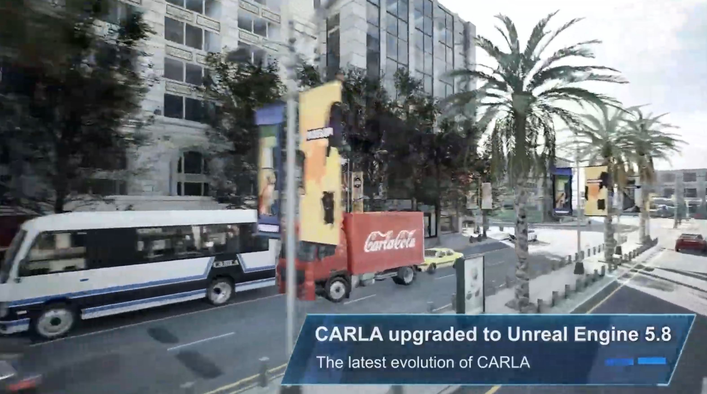

## 视频

### 核心功能亮点

* **Carla 中的智能体**：只需描述您的需求，AI 编程智能体即可自动执行相应操作。CARLA 团队精心打造并验证了 64 个操作流程，涵盖环境配置、构建、打包、资源导入、传感器设置、场景构建、排行榜（Leaderboard）以及 ROS 2 集成等；通过 CARLA MCP（模型上下文协议）服务器，任何支持该协议的智能体均可调用这些功能。

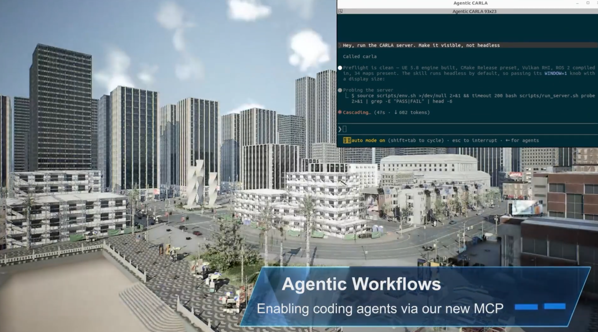

* **顶尖的传感器仿真**：支持多种传感器，包括各类摄像头（RGB、深度、分割、光流、鱼眼）、激光雷达（LIDAR）、雷达、GNSS、IMU 及 V2X 系统。其中，基于光线追踪的镜头模拟采用真实镜头模型进行路径追踪（path tracing），且摄像头配置文件均基于真实汽车数据集进行了校准。系统可为每一帧提供语义分割、实例分割、深度信息及边界框（bounding box）等“真值”（ground truth）数据。

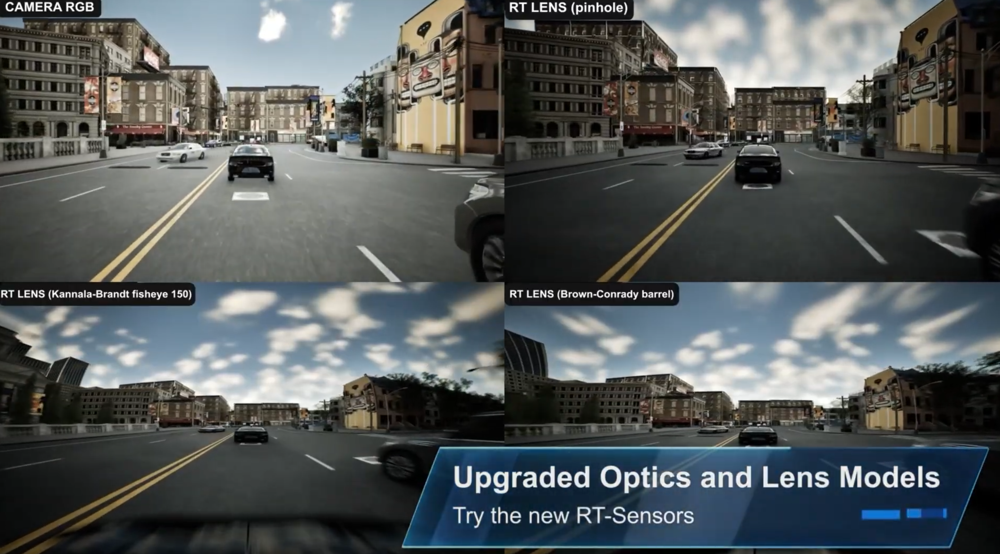

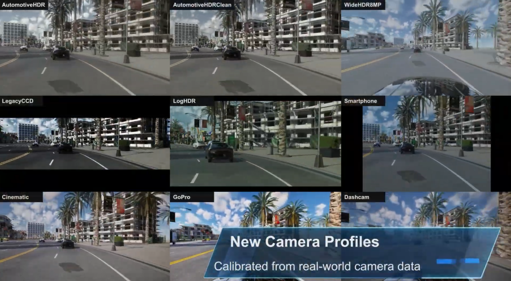

* **NVIDIA 生态系统集成**：NuRec 可将真实的驾驶记录转化为 CARLA 可仿真的场景；Cosmos 世界模型能将 CARLA 中的驾驶场景转化为具有照片级真实感的变体；Alpamayo 2 支持闭环仿真；DLSS 4.5 则可显著提升摄像头渲染性能。

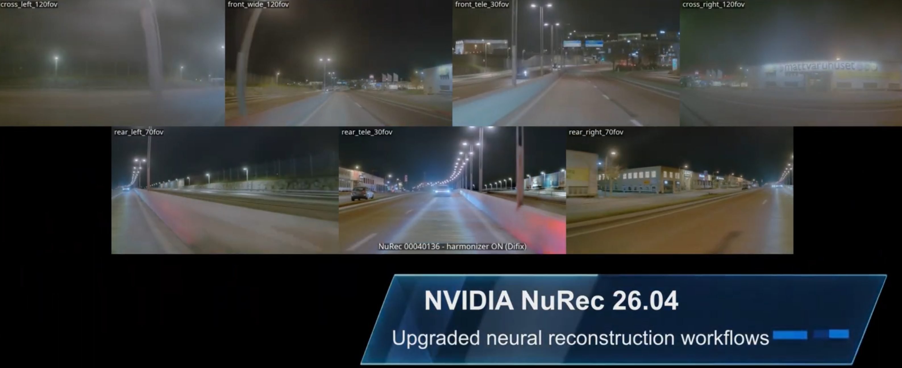

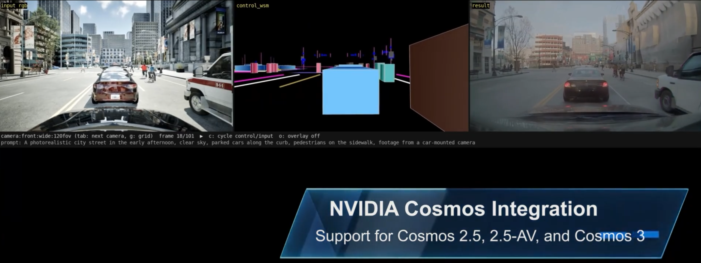

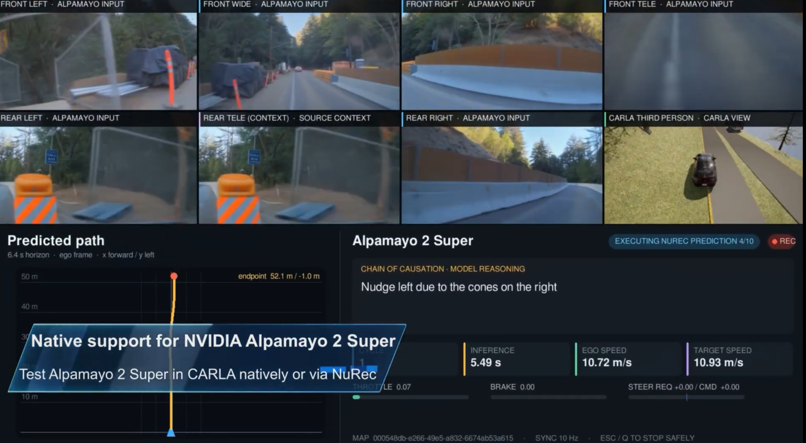

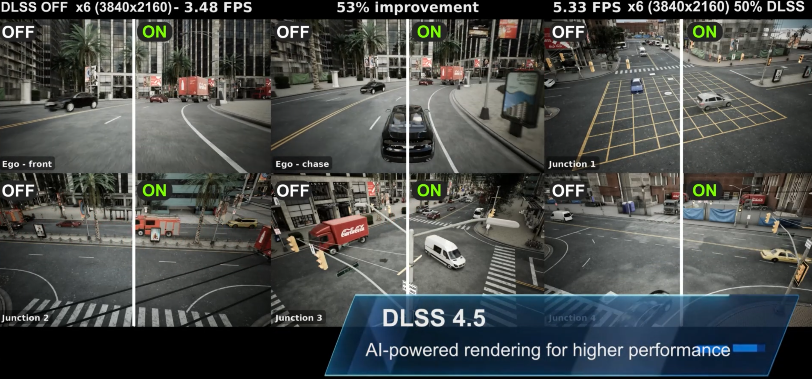

* **Unreal Engine 5.8**：利用“世界分区”（World Partition）和“大世界坐标”（Large World Coordinates）技术，支持构建长达数公里的地图；集成 Lumen 全局光照、硬件光线追踪及路径追踪功能。
丰富的开放内容：包含 15 张地图（从经典城镇到 Town12、Town13 和 Town15 等大型地图）、26 种车辆、37 个行人模型、82 种道具以及动态天气系统。查看完整目录。

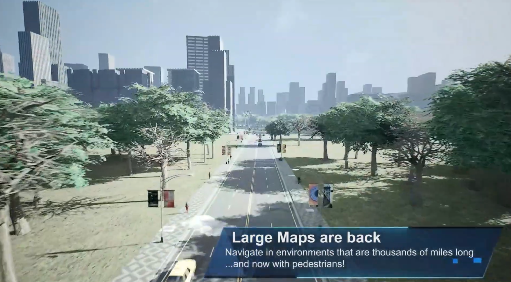

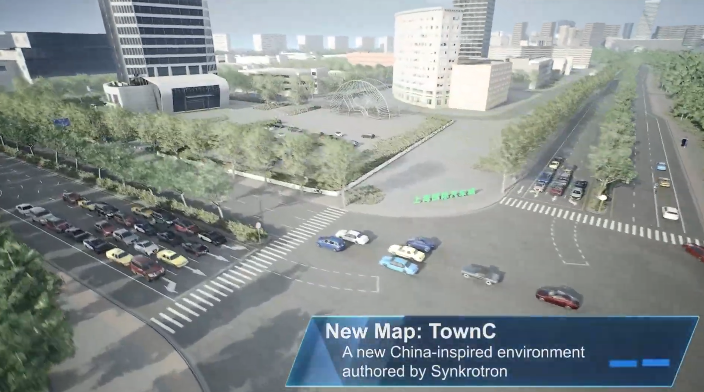

* **基于“服务器-多客户端”架构的可扩展性**：多个客户端（可在同一节点或不同节点上运行）能够分别控制不同的仿真主体（actors）；此外，还支持通过辅助服务器在其他 GPU 上进行传感器渲染。

* **灵活的 API**：CARLA 提供功能强大的 Python 和 C++ API，允许用户全面掌控仿真过程，包括交通流生成、行人行为、天气状况、传感器配置等。其中，Python API 支持 Python 3.10 至 3.15 版本。

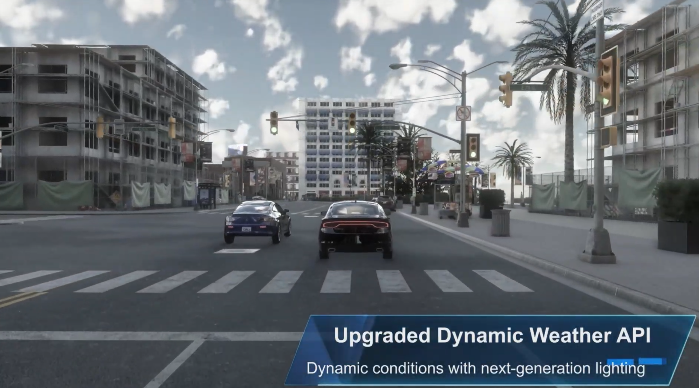

* **面向规划与控制的高效仿真**：提供“无渲染模式”（no-rendering mode），可在无需图形渲染的情况下快速执行交通仿真及道路行为模拟。

* **地图生成**：用户可通过 RoadRunner 等工具，按照 ASAM OpenDRIVE 标准创建自定义地图，转换 OpenStreetMap 数据，并将地图、车辆及道具打包成内容包进行共享，无需重新构建 CARLA。

* **交通场景仿真**：通过 ScenarioRunner（支持 Python 脚本场景及 OpenSCENARIO 标准）、Scenic 以及 CARLA Leaderboard，用户可以定义、执行并评估各类交通场景。

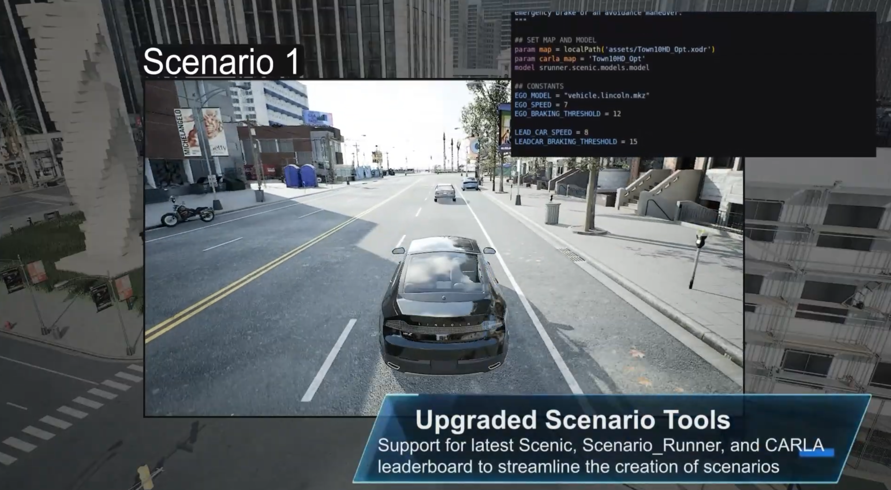

* **原生 ROS 2 集成**：服务器通过 ROS 2 发布传感器数据并接收车辆控制指令，无需额外的桥接进程；用户可在启动时选择中间件（支持 FastDDS、CycloneDDS 或 Zenoh）。

* **自动驾驶技术栈**：Autoware 可在原生 ROS 2 环境下直接运行；NVIDIA Alpamayo 2 Super 则支持在 CARLA 地图或 NuRec 场景中实现闭环自动驾驶仿真。

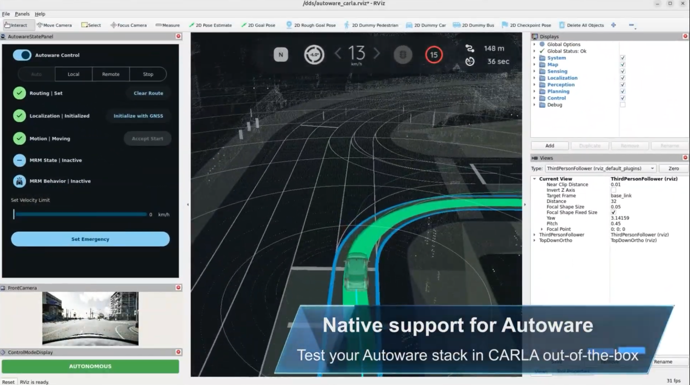

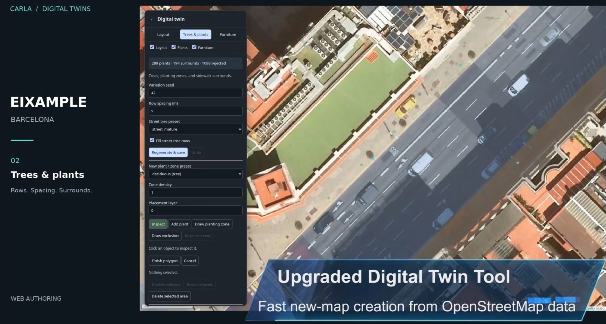

## 开源孪创社区的接力

由于维护成本等原因，Carla 社区同时正式宣布不再维护 UE4 的分支。

考虑到 UE4 在稳定性与功能完整度、硬件门槛与资源消耗、生态与工具链兼容性等方面的优势，我们开源孪创社区将继续 Carla 社区的工作，同时支持 VR 驾驶舱、无人机、水下机器人、具身机器人一体仿真，合并 UE5 相关特性，持续优化和新增更多机器人相关特性。

   

## 参考

* [CARLA 1.0 Release](https://carla.org/)
